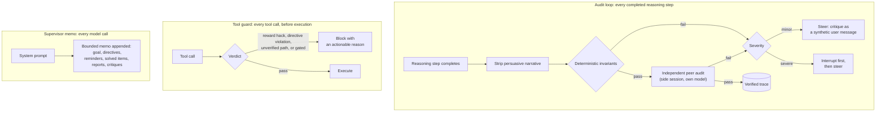

# opencode-supervisor

A supervisor for your OpenCode agent. While the agent works, this plugin
audits every completed reasoning step, steers or interrupts the session
when a step is wrong, blocks reward-hacking and out-of-bounds tool calls
before they execute, and keeps the agent oriented with a running memo of
the goal, reminders, and engineer directives.

Coding agents fail in predictable ways: an arithmetic slip in step 2 of
a 10-step plan quietly poisons steps 3 through 10; a stuck agent "fixes"
a failing test by adding `.skip()`; an agent asked to fix a bug starts
refactoring the module. Standard workflows check only the final output —
by then the damage is load-bearing. opencode-supervisor checks the work
while it happens.

---

## 1. What You Get

- **[The audit loop](#41-the-supervision-loop)** — every completed
  reasoning step is stripped of persuasive narrative and audited by
  an independent peer model in a side session. Failures steer the
  agent; severe failures interrupt it first.
- **[The tool guard](#42-the-tool-guard)** — reward-hacking calls,
  directive violations, and hallucinated file paths are blocked
  before a tool executes; gated calls wait for engineer sign-off.
- **[The supervisor memo](#43-the-supervisor-memo)** — a bounded memo
  (goal, directives, reminders, solved items, reports, critiques)
  rides the conversation as one trailing user message every turn.
- **[The agent console](#5-the-agent-console)** — five self-serve
  tools: durable reminders, full-state recall, engineer reports,
  on-demand audits.
- **[The engineer console](#6-the-engineer-console)** — directive
  files pairing advisory text with machine rules (`when`, `enforce`,
  `approve`, `review`, `repair`) that shape the memo, the audit
  criteria, and the tool guard.
- **[Tool-arg repair](#45-tool-arg-repair)** — malformed tool-call
  arguments (`{"questions": null}` where an array belongs, a
  JSON-stringified array, one call's fragments split across array
  elements) are repaired before the tool executes: deterministic
  structure fixes first, then a bounded repair-model side session.
  Run standalone with `mode: "repair-only"`.

---

## 2. What It Catches

| Failure mode | Example | What the supervisor does |
| :--- | :--- | :--- |
| Arithmetic errors | `24 * 15 = 340`, `9+3+2=56` in a budget step | An invariant fails the audit with no model call (equations evaluate as full chains); the critique names the whole stated expression |
| Off-by-one bounds | `for (let i = 0; i <= array.length; i++)` | Flagged by an invariant or the peer audit; the agent self-corrects |
| Unsafe code | SQL string interpolation, unsafe shell commands | The peer audit flags the step before the code reaches disk |
| Reward hacking | `.skip()` on a failing test, deleted asserts, `git commit --no-verify` | The tool guard blocks the call before execution |
| Hallucinated paths | Editing a file never named in verified reasoning | The tool guard blocks the write unless the verified trace names the path |
| Scope drift | Asked to fix a bug, starts refactoring the module | The audit prompt carries the session goal; drift is a finding |
| Malformed tool arguments | `{"questions": null}` where an array belongs, a JSON-stringified array, one call's fragments split across array elements | Tool-arg repair fixes the arguments before execution — deterministically when structure allows, otherwise a repair model recovers values from the assistant's reasoning (Section 4.5) |

The loop is not code-specific: the same technique catches bad math in
financial calculations, unit-conversion errors in data pipelines, and
plan steps that contradict earlier constraints.

---

## 3. Quickstart

```bash
git clone https://github.com/jflowers/opencode-supervisor.git
cd opencode-supervisor
bun install        # the plugin entry imports @opencode-ai/plugin
```

Register the plugin through one of OpenCode's three real mechanisms:

**Option A — project config `plugin` array** (this repository's own
pattern). Add the entry to the `opencode.json` of the project OpenCode
runs in:

```json
{
  "plugin": [
    "./index.ts"
  ]
}
```

Relative specs resolve against the config file's directory. From a
different project, use an absolute path to this repository's
`index.ts`.

**Option B — the `opencode plugin` command**:

```bash
opencode plugin /absolute/path/to/opencode-supervisor
```

Registers in the current project's `.opencode/opencode.json`
(`--global` for the global config). Pass an absolute path: a relative
spec is written verbatim, then resolves against `.opencode/`, where it
points nowhere and is silently dropped.

**Option C — auto-discovery**. OpenCode loads every `*.ts` / `*.js`
file directly under a `plugin/` or `plugins/` directory in a config
directory. Use a symlink, not a copy: the entry imports `./src/*`, and
a copy would lose those relative imports.

Start `opencode` in the project; verify an install with `bun test`
(Node 22+: `npm run test:node`). Prefer no middleware? See
[Section 8](#8-middleware-or-skill).

---

## 4. How It Works

### 4.1 The Supervision Loop



1. **Observe.** The `event` hook receives completed reasoning parts
   (deduplicated by session, message, and part identity); the
   session's first user message is captured as the goal.
2. **Strip.** `stripNarrative` removes persuasive conversational text
   (*"Obviously, this formula is optimal"*) and keeps the formal
   steps — code, equations, explicit rules — so confidence prose
   cannot talk the auditor into agreement.
3. **Audit.** Deterministic invariants run first: arithmetic
   misstatements (equations evaluate as full chains — `38+16+2=56`
   verifies as one expression, with standard precedence), off-by-one
   loop bounds, and reward-hacking markers fail with no model call.
   Surviving steps go to an independent auditor model in a dedicated
   side session — created per audit through the OpenCode client
   (`auditorModel` / `auditorVariant`), with the session goal and
   engineer directives in the prompt, so scope drift and directive
   violations are also findings. Audit traffic never enters the
   supervised conversation; auditor errors fail open. Steps join the
   **verified trace** as outcome-carrying entries: passed steps
   record normally, and a step that failed a minor invariant
   critiques without losing its place — the entry stays, marked
   unpassed, so the file reasoning the tool guard matches against
   survives one misstated tally. Severe findings and peer-audit
   failures still evict. While an audit runs it is registered as
   in-flight for the session: a tool call that would block on the
   trace check waits for the settled trace instead of seeing the
   partial one (Section 4.2).
4. **Intervene.** A `minor` failure (arithmetic, off-by-one, scope
   drift) arrives as a `[supervisor]`-prefixed user message the agent
   incorporates at its next step; a `severe` failure (reward hacking)
   aborts the session first — the abort precedes the delivery so it
   clears the flawed turn the critique exists to correct.
   Interventions are bounded by `maxRegenerations` (default 2) per
   session; past the bound — and on transport failures — findings
   are recorded without delivery.

### 4.2 The Tool Guard

Before any tool runs, `tool.execute.before` checks the call:
reward-hacking patterns, directive violations (forbidden paths and
command patterns), file paths absent from the verified trace, and
touches on the supervisor's engineer-authored state (the approvals
file, the supervisor config files, the directives directory, and the
whole `.opencode/supervisor` directory — FR-061) are blocked. A
block throws, so the model receives the reason as a tool
error it can act on. The trace check scans operational arguments
only: for tools other than bash, values under the content keys
(`content`, `oldString`, `newString`) are authored data — a filename
quoted in written content is a mention, not a touch — while every
other argument key, including custom and MCP names, stays scanned
(coverage fails closed for unknown tools). Bash command strings stay
operational in full, so content embedded in a bash heredoc is still
scanned and can false-positive — a fail-closed residual carried from
the protected-state posture. Path tokens carry pattern semantics: a
wildcard- or variable-bearing argument (`kb/topics/*.md`,
`"$bdir/$id.md"`) is a pattern whose runtime expansion is unknown —
it passes when the verified trace references a satisfying path or
the pattern spelling itself, and otherwise blocks naming the
pattern (never a phantom expansion like `id.md`); extension matches
carry a trailing boundary, so `config.json` tokenizes whole. The
reverse direction holds too (FR-069): a concrete path passes when
the trace carries a path-scoped pattern (`kb/topics/*.md` — at
least one directory segment) whose compiled glob covers it, by
full path or slash-boundary suffix, case-insensitively — so
glob-form reasoning covers the batch of writes it describes,
while a bare filename glob (`*.md`) covers nothing. A
trace block never fires on a partial trace while the session's
audit is still in flight: the guard waits for the audit
continuation to settle — bounded at 10 seconds, one wait per call —
then re-checks the settled trace before blocking or allowing. A
rejected continuation counts as settled (logged once, never thrown
into the guard). On timeout the call fails open — the live agent's
progress outranks one unverified call — up to `maxTimeoutFailOpens`
per session (default 3, Section 7); past the cap a timed-out wait
blocks naming the still-unsettled audit, so the model can wait and
retry. When the blocked path is provably named by an in-flight
audit's step text (a covered wait — the corrective reasoning is
already under audit), timeout fail-opens charge a separate
`maxCoveredTimeoutFailOpens` budget (default 6) instead, and a
settled wait that still blocks while the correction was audited
but evicted says so in the reason rather than blaming absent
reasoning (FR-070). Passing calls, the empty-trace allow, and reward-hacking or
directive blocks never charge the wait — their causes are not trace
races. `approve` gates hold matching calls for engineer
approval; `review` gates hold calls until a passed peer audit
references the path (Section 6). An empty trace or rule set never
blocks, and the plugin's own console tools are exempt from the
trace check — derived from the registered tool map, so
`request_audit` stays reachable and a future console tool is
covered automatically; the reward-hacking check still applies to
them. After each tool completes, a solved item (tool name +
short outcome) joins a bounded log.

### 4.3 The Supervisor Memo

Before each user prompt, `experimental.chat.messages.transform` appends a
bounded memo to the conversation as one trailing user message: session goal,
active directives, reminders, recently solved items, agent reports, and
recent critiques. The message is transform-time only (never persisted,
rebuilt fresh each turn) and is wire-verified against OpenCode 1.19.0 —
the earlier `system.transform` delivery was dropped by that build
(Section 9).

### 4.4 Hook Map

The plugin entry (`index.ts`) default-exports a `PluginModule`
(`{ id, server }`, id `opencode-supervisor`); `server(input, options)`
returns this hook map (options carry engineer directives through
tuple registration — Section 6):

| Hook | Purpose |
| :--- | :--- |
| `event` | Observes completed reasoning parts (`message.part.updated`), deduplicates them, strips narrative, runs the invariants and the side-session peer audit, records steps in the verified trace (passed, or minor deterministic findings marked unpassed), and routes failures to critique delivery. |
| `chat.message` | Captures the session's model identity (drives the tool-arg repair schema lookup) and the first user message of the session as the goal. The goal is never replaced. |
| `tool.execute.before` | Tool-arg repair first: validates raw arguments against the tool's JSON schema and repairs malformed ones in place (Section 4.5). Then the tool guard: blocks reward-hacking tool calls, engineer-directive violations, and file paths absent from the verified trace (never blocks when the trace is empty; a trace block with an audit in flight waits up to 10 s for the settled trace, failing open up to the per-session `maxTimeoutFailOpens` cap — Section 4.2); holds approve-gated calls for engineer approval and review-gated calls for a passed peer audit (agent-console tools are exempt so `request_audit` stays reachable); records directive triggers. |
| `tool.execute.after` | Appends a solved item (tool name + short outcome) to a bounded log. |
| `tool` | Agent console: registers `remind_me` / `forget_reminder` (durable reminders), `recall` (full retained state), `report` (self-reported events), and `request_audit` (on-demand peer audit) (Section 5). |
| `experimental.chat.messages.transform` | Appends the supervisor memo to the conversation as one trailing user message per user prompt. Degrades gracefully (memo-less operation) when the hook is absent. |
| `dispose` | Clears all in-process session state. |

All logic lives in pure `src/` modules that import no OpenCode APIs;
hooks and session state live only in `index.ts`, in module-level Maps
keyed by session ID that die with the opencode process. See
`AGENTS.md` for the module map. In `repair-only` mode the `event`,
`tool`, and messages-transform hooks stay unregistered — only the
model capture, the repair pass, `tool.execute.after`, and `dispose`
remain.

### 4.5 Tool-Arg Repair

Some models emit structurally broken tool-call arguments: an array
field arrives as `null`, a serialized array arrives as a JSON string,
or one call's fragments are split across array elements. GLM 5.3 on
one provider served all three shapes to the `question` tool, burning
turns on schema-error retry loops. The repair pass fixes such calls
before execution.

The pass runs first inside `tool.execute.before`:

1. **Validate.** The raw arguments are checked against the tool's
   JSON schema, fetched through `client.tool.list` for the session's
   model and cached per provider/model. The model identity comes from
   `chat.message`, falling back to the persisted assistant message
   carrying the call.
2. **Repair deterministically.** Structure fixes apply first, each
   gated by re-validation: parse JSON-stringified values, extract
   embedded JSON from garbled strings, wrap a single object in an
   array, merge fragment-run splits, drop null optionals. These make
   no model call and are not bounded.
3. **Repair with a model.** Unresolved cases go to a repair-model
   side session — by default the resolved auditor model (including
   the derived host-model fallback), or a dedicated one through
   `argRepair.model` / `OPENCODE_SUPERVISOR_REPAIR_MODEL`. The prompt
   carries the tool, the schema, the emitted arguments, the
   validation issues, and the assistant reasoning text as evidence,
   under a no-invention rule: values are recovered verbatim or the
   call is declared unrepairable.
4. **Apply.** Repaired arguments are re-validated against the schema
   and merged in place, so the guard, the recorded tool-part input,
   and execution all see one object.

The pass never throws — every failure fails open to OpenCode's normal
schema error. The scope defaults to the builtin tool ids
(`argRepair.tools`; `"*"` covers everything including MCP and plugin
tools, and `repair` directive rules add tools by name or glob —
Section 6). Model-tier attempts are bounded per session
(`argRepair.maxPerSession`, default 8), and the side session times
out at `argRepair.timeoutMs` (default 15000). In full mode a repaired
call logs a solved item.

Run the pass standalone — no audit loop, guard, memo, or console —
with:

```json
{
  "mode": "repair-only",
  "argRepair": {
    "model": "openrouter/deepseek/deepseek-v4-pro"
  }
}
```

---

## 5. The Agent Console

The plugin registers five tools (`Hooks.tool`) the supervised agent
can call like any other tool:

- **`remind_me` / `forget_reminder`** — durable session reminders:
  dead ends ("the flaky import always fails — use the direct path
  instead"), environment quirks, decisions, user constraints. A
  stored reminder re-enters context two ways: a `Reminders:` section
  in the memo (re-injected every turn, surviving context compaction)
  and the tool result echo (so it lands even when the gateway drops
  the memo). Stable ids (`r1`, `r2`, ...) are never recycled.
- **`recall`** — read-only view of the full retained state: `goal`,
  `reminders`, `solved`, `critiques`, or `all`. Storage retains
  deeper than the memo renders (50 solved items, 30 critiques), so
  recall reaches items the memo's recency caps dropped.
- **`report`** — records a self-reported event for the engineer:
  `blocker` (stuck, need input), `deviation` (departed from plan or
  goal), `outcome` (worth surfacing), `note`. Reports appear in an
  `Agent reports:` memo section and are echoed in the tool result.
- **`request_audit`** — asks for an immediate peer audit of a stated
  claim. The focus runs through the same pipeline as reasoning
  steps: a pass joins the verified trace, a fail returns the
  critique in the tool result — never steering, interrupting, or
  consuming the regeneration budget. Bounded per session
  (`maxOnDemandAudits`, default 8); the automatic audit loop is
  unaffected.

Console-tool behavior: whitespace-only text is rejected; text over
2000 characters is truncated (both reported in the result); side
sessions get inert results; tool bodies fail open — malformed
arguments yield actionable results, never thrown errors; report text
never enters audit prompts.

---

## 6. The Engineer Console

Engineers supervise through directive files and plugin options. A
directive is advisory text plus optional machine rules:

- **Advisory text** (the markdown body) rides the supervisor memo and
  becomes an audit criterion — the peer auditor flags steps that
  violate it. Unconditioned directives ride the memo every turn; a
  directive with `when` rules surfaces only after a tool call
  matches.
- **`enforce` rules** block tool calls before execution: `forbidPath`
  (glob: `*`, `**`, `?`) and `forbidPattern` (regex,
  case-insensitive). The block reason names the directive, the
  match, and the advisory text. An empty rule set never blocks.
- **`when` rules** surface a directive just-in-time: `tool` (name,
  case-insensitive) or `path` (argument-path glob). Blocked calls
  still record the trigger.
- **`approve` rules** hold matching tool calls for engineer approval:
  `id` (optional explicit gate key, else `<directive>/<rule
  index>`) and any of `tool`, `path` (glob), `pattern` (regex) — all
  present criteria must match, following `enforce` semantics.
- **`review` rules** hold matching tool calls until the verified
  trace references the touched path (`path`, glob). The peer auditor
  is the reviewer — a passed audit referencing the path is the
  sign-off, and `request_audit` can produce one immediately. Review
  gates block on an empty trace.
- **`repair` rules** add matching tools (`tool`, name or glob,
  case-insensitive) to the tool-arg repair scope (Section 4.5) — the
  escape hatch for MCP and plugin tools outside the builtin default.

Directive files live in `.opencode/supervisor/directives/*.md`; the
markdown body is the advisory text, and a fenced `supervisor` code
block carries the rules as JSON:

````markdown
Never read, print, or copy secret material. Secrets live in the
vault, not the repo. If a task seems to require a secret, ask the
engineer instead.

```supervisor
{
  "enforce": [{ "forbidPath": "secrets/**" }],
  "when": [{ "tool": "bash" }, { "path": "src/crypto/**" }]
}
```
````

Directives can also ride plugin options through tuple registration in
`opencode.json`:

```json
{
  "plugin": [
    ["/absolute/path/to/opencode-supervisor", {
      "directives": [{ "id": "prefer-bun", "text": "Run tests with bun, not node." }]
    }]
  ]
}
```

File directives load first (sorted by filename), then option
directives append. Bounds are fixed: 20 directives, 1000 characters
of advisory text per directive, 10 rules of each kind per directive,
and a 4000-character aggregate render budget. Malformed files and
invalid rules are skipped with a warning — loading fails open.
Directives load once at plugin start; there is no hot reload.

**Approvals.** `approve` gates read
`.opencode/supervisor/approvals.json` fresh at each gated call — a
JSON array of `{ "gate": "<key>", "note": "...", "expires":
"YYYY-MM-DD" }` records (at most 50, most recent kept). Adding an
entry approves the gate on the next matching call; removing one
revokes it; `expires` is evaluated at UTC end of day (the expiry day
itself still counts). Verification fails closed — an unreadable or
malformed approvals file blocks the gated call carrying the error,
while an absent file simply means "not approved". Agent calls
touching the supervisor's engineer-authored state are blocked by
default: any path whose final segment is `approvals.json` (lookalike
names like `stale-approvals.json` are not blocked), the supervisor
config files, the directives directory, and the whole
`.opencode/supervisor` directory run — ancestor spellings like
`rm -rf .opencode/supervisor` included. Traversal (`..`) collapses
and slash-free `cd` spellings are caught by a raw scan of the bash
command string, and the block reason names the protected object, so
the agent cannot self-approve a gate or defang its own supervisor.
Agent-console tools are exempt from both gate kinds.

---

## 7. Configuration

Settings resolve in order of precedence at runtime:

1. **Environment variables** — the `OPENCODE_SUPERVISOR_*` names in
   the table below.
2. **Project config file** — `<project>/.opencode/supervisor/config.json`
   (any subset of the knobs below, as a JSON object).
3. **Plugin options** — the `config` key of the plugin's tuple
   registration in `opencode.json`.
4. **Global config file** —
   `${XDG_CONFIG_HOME:-~/.config}/opencode/supervisor/config.json`.
5. **Derived model** (`auditorModel` only) — the host's `small_model`,
   then `model`, read from the OpenCode config; the lookup times out
   after 5 seconds and, after five consecutive failures, backs off
   for 60 seconds between attempts (deterministic invariants stay
   active throughout).
6. **Defaults** — the `pluginConfig` object at the top of `index.ts`.

> A session-plugin-config tier exists in the resolver, but no runtime
> hook payload carries one (verified against `@opencode-ai/plugin`
> 1.19.4) — configure through the environment or the config files.

Config files accept any subset of the knobs below; unknown keys are
ignored, and a malformed or wrong-typed file is skipped with one
warning in the server log (fail-open, like directive loading). Files
are read once at plugin start — a size bound of 64 KiB applies, and
changes require an OpenCode restart to take effect (the approvals
file is the deliberate contrast: it is re-read fresh per gated
call). The config files are engineer-authored state: supervised tool
calls touching them (or the directives directory) are blocked, like
the approvals file — traversal and slash-free `cd` spellings are
covered too. There
is no default auditor model: with no tier setting one, the LLM audit
tier is skipped entirely — deterministic invariants, the tool guard,
and the memo remain active — and a warning names the state.
`argRepair.model` defaults to the resolved auditor model, so a
derived host model covers both. The `auditorVariant` is optional;
when unset, the side-session prompt omits it.

| Knob | Environment variable | Default | Description |
| :--- | :--- | :--- | :--- |
| `auditorModel` | `OPENCODE_SUPERVISOR_MODEL` | *(none — derived from the OpenCode `small_model`/`model`)* | The provider and model slug for the auditor side session. Format: `<provider>/<model-id>` (for example, `openai/o3-mini` or `anthropic/claude-3-7-sonnet`). |
| `auditorVariant` | `OPENCODE_SUPERVISOR_VARIANT` | *(unset — omitted)* | The reasoning effort passed to the auditor model. Allowed values: `minimal`, `low`, `medium`, `high`, `default`. Omitted from the side-session prompt when unset. |
| `maxRegenerations` | `OPENCODE_SUPERVISOR_MAX_REGENERATIONS` | `2` | The maximum number of interventions per session — delivered critiques and severe interrupts share this bound. Past the bound, critiques (severe included) are recorded without delivery or interrupt. |
| `stripMode` | `OPENCODE_SUPERVISOR_STRIP_MODE` | `code_and_math` | Controls how `stripNarrative()` filters the Chain-of-Thought before the audit. See Section 7.1 below. |
| `blockRewardHacking` | `OPENCODE_SUPERVISOR_BLOCK_REWARD_HACKING` | `true` | When `true`, the tool guard blocks tool calls that contain `--no-verify`, `.skip(`, `expect(true).toBe(true)`, or test deletion commands. |
| `requireStepReferenceInTools` | `OPENCODE_SUPERVISOR_REQUIRE_STEP_REFERENCE_IN_TOOLS` | `true` | When `true`, the tool guard blocks tool calls whose file-path arguments do not appear in the verified reasoning trace. Never blocks when the trace is empty. |
| `memoLimits.maxSolvedItems` | `OPENCODE_SUPERVISOR_MEMO_MAX_SOLVED_ITEMS` | `5` | Cap on solved items shown in the memo. Storage retains more (50) for `recall`; this knob bounds the rendered view. |
| `memoLimits.maxCritiques` | `OPENCODE_SUPERVISOR_MEMO_MAX_CRITIQUES` | `3` | Cap on critiques shown in the memo. Storage retains more (30) for `recall`; this knob bounds the rendered view. |
| `memoLimits.maxReminders` | `OPENCODE_SUPERVISOR_MEMO_MAX_REMINDERS` | `10` | Cap on reminders kept in state and shown in the memo (the most recent are kept). |
| `memoLimits.maxReports` | `OPENCODE_SUPERVISOR_MEMO_MAX_REPORTS` | `5` | Cap on agent reports kept in state and shown in the memo (the most recent are kept). |
| `maxOnDemandAudits` | `OPENCODE_SUPERVISOR_MAX_ON_DEMAND_AUDITS` | `8` | Per-session cap on audits requested through the `request_audit` tool. The automatic audit loop is unaffected. |
| `maxTimeoutFailOpens` | `OPENCODE_SUPERVISOR_MAX_TIMEOUT_FAIL_OPENS` | `3` | Per-session cap on trace-check waits that time out and fail open (the wait itself is bounded at 10 seconds). Past the cap a timed-out wait blocks naming the still-unsettled audit. |
| `maxCoveredTimeoutFailOpens` | `OPENCODE_SUPERVISOR_MAX_COVERED_TIMEOUT_FAIL_OPENS` | `6` | Per-session cap on covered timeout fail-opens — waits whose blocked path an in-flight audit's step text names (the corrective reasoning is under audit). Past the cap a covered timed-out wait blocks naming the still-unsettled audit. |
| `mode` | `OPENCODE_SUPERVISOR_MODE` | `full` | `full` runs everything; `repair-only` registers only the tool-arg repair pass (Section 4.5). |
| `argRepair.enabled` | *(config file/options only)* | `true` | Master switch for the tool-arg repair pass. |
| `argRepair.model` | `OPENCODE_SUPERVISOR_REPAIR_MODEL` | *(the resolved auditor model)* | Repair-model slug, `<provider>/<model-id>` (for example, `openrouter/deepseek/deepseek-v4-pro`). Inherits the auditor's derived host-model fallback. |
| `argRepair.tools` | *(config file/options only)* | builtin tool ids | Tools in the repair scope; `"*"` covers everything including MCP and plugin tools. |
| `argRepair.maxPerSession` | *(config file/options only)* | `8` | Per-session bound on repair-model attempts; deterministic repairs are unbounded. |
| `argRepair.timeoutMs` | *(config file/options only)* | `15000` | Timeout on the repair side session. |

Gate approvals are not a knob: `approve` rules read the approvals file
fresh at each gated call, so approving or revoking takes effect on
the next tool call with no restart (Section 6).

Environment variable values: booleans accept exactly `true` or
`false`; numbers must be non-negative; `stripMode` must be one of the
three mode names; `mode` must be `full` or `repair-only`. Invalid
values fall through to the next precedence tier.

All plugin diagnostics go to the OpenCode server log (service tag
`opencode-supervisor`) through the `/log` endpoint — never to
stdout/stderr, so `[supervisor]` lines cannot corrupt the TUI.
Delivery is fire-and-forget (a server listener that is not up yet
absorbs the loss), repeated warn/error entries dedupe per message
(dedupe memory is bounded — 512 entries — so when the cap fills and
clears, a previously seen pair can warn again; bounded memory was
chosen over recurrence visibility), and the identity line logs once
at the first hook invocation.

### 7.1 Understanding `stripMode`

- **`code_and_math` (default)** — retains steps containing code
  blocks, math operators, SQL keywords, variable assignments, or a
  file-path token: plain prose naming a file (*"I will update
  notes.md"*) survives so the tool guard's corrective instruction
  stays followable (Section 4.2); removes other pure prose. For
  general coding and math tasks.
- **`balanced`** — everything in `code_and_math`, plus prose stating
  formal specifications, complexity, preconditions, or invariants.
  For architecture and security reviews.
- **`strict`** — only fenced code blocks and explicit equations.
  Zero natural language.

---

## 8. Middleware or Skill?

The audit technique also ships as a standalone, prompt-based skill —
no middleware required:

```bash
mkdir -p ~/.config/opencode/skills/reasoning-auditor
cp skills/reasoning-auditor/skill.md ~/.config/opencode/skills/reasoning-auditor/
```

| Capability | Middleware | Skill |
| :--- | :--- | :--- |
| Audit | Independent peer model in a side session, plus deterministic invariants | Same technique, self-applied through prompt instructions |
| Critique delivery | Steers or interrupts the session automatically | The model must follow the skill's instructions |
| Tool guard, memo, agent console, engineer console | Yes | No |
| Setup | Plugin registration | Copy one file |

---

## 9. Limitations and Compatibility

- Tested against OpenCode **1.19.0** and `@opencode-ai/plugin`
  **^1.19.4**. The memo uses the experimental
  `experimental.chat.messages.transform` hook and degrades gracefully
  (memo-less operation) when the hook is absent.
- OpenCode 1.19.0 discards `experimental.chat.system.transform` payload
  mutations — the request is built from the pre-hook system array, so
  the original system-prompt memo delivery never reached the model
  (evidence: `openspec/changes/audit-supervisor/design.md`). Gateways
  and the AI SDK chain were exonerated by direct wire capture. The
  memo now rides `experimental.chat.messages.transform` (payload
  mutations wire-verified on the same build) as one trailing user
  message per user prompt.
  Reminders carry a second channel: the `remind_me` result echoes the
  stored text into the conversation.
- The critique is delivered as a synthetic-marked user message; the V1
  OpenCode client exposes no other option (verified against 1.19.0).
- Interventions are bounded by `maxRegenerations` (default 2) per
  session; past the bound, severe findings are recorded without
  delivery. The reward-hacking block stays active independent of the
  bound.
- Supervision state is in-process only; restarting OpenCode clears the
  goal, the verified trace, and the logs.
- The derived host-model fallback resolves through
  `client.config.get` with a 5s timeout; while it keeps failing,
  hook-blocking paths absorb up to 5s per lookup and ~25s
  cumulatively before the 60s backoff engages (FR-058 residual).
- The verified-trace path check is best-effort: a tool call racing
  an in-flight audit waits up to 10 seconds for the audit to
  settle, then fails open — up to `maxTimeoutFailOpens` (default 3)
  timed-out waits per session, past which the call blocks naming
  the still-unsettled audit. Waits whose blocked path an in-flight
  audit's step text names fail open against
  `maxCoveredTimeoutFailOpens` (default 6) instead (FR-070). An
  empty trace never blocks. Directive
  globs are root-anchored and case-insensitive;
  `**/`-prefixed globs cover deeper spellings.
- Path-bearing survival (Section 7.1) is mode-scoped and
  content-blind: a step that names a file *and* argues in prose
  survives `code_and_math` and `balanced` whole, so persuasion
  riding path-bearing prose reaches the auditor — deterministic
  tiers do not judge narrative, and under a no-`auditorModel`
  install only the deterministic markers filter it (FR-060). In
  `strict` the step still drops. A timed-out trace wait that fails
  open can execute a path the settled trace never verified — the
  bounded fail-open trades one unverified call for a live agent
  (FR-067 residual).
- A blocked tool surfaces as an error tool result, so the model may
  retry the call (bounded by OpenCode's doom-loop check). Agent
  reports are self-reported and unaudited; recall is read-only.
- The whole `.opencode/supervisor` directory is engineer-authored
  state protected by the guard itself (a normalized path-token lens
  plus a raw bash command lens), so an `enforce` `forbidPath` rule
  over `.opencode/supervisor/**` is optional defense-in-depth.
  Residuals: bash heredoc/echo prose can false-positive the raw
  lens; write/edit content (`content`, `oldString`, `newString`)
  is never scanned (content is data, not operation), while other
  payload keys (`text`, `body`, `document`, `patch`, `diff`,
  `edits`, `data`) are not on that blocklist, so their content
  is scanned and can false-positive — accepted fail-closed;
  variable indirection (`cat $CFG`) is not caught; the
  directory backstop uses the path lens only. Review gates block
  the first matching calls of a session until a passing audit
  references the path.

---

## 10. Appendix

### 10.1 Background

The audit loop applies a published multi-agent reasoning-audit-and-
repair technique. Research shows that when one AI model reviews
another's full Chain-of-Thought, the reviewer often agrees with wrong
answers, because the primary model writes confident narrative around
its mistakes. The framework counters this by (1) separating logic from
narrative — stripping rhetorical text so the auditor sees only raw
logic, math, and code — and (2) repairing from the exact broken step,
naming the step number and the formal error. Source: [A new framework
teaches AI models to audit and repair each other's reasoning,
improving accuracy
(VentureBeat)](https://venturebeat.com/orchestration/a-new-framework-teaches-ai-models-to-audit-and-repair-each-others-reasoning-improving-accuracy).

### 10.2 Migrating from 1.x

Formerly `opencode-reasoning-audit` (1.x). Version 2.0.0 renames the
plugin and its configuration surface; the break is clean — 1.x names
are not read as aliases.

| 1.x variable | 2.0.0 variable |
| :--- | :--- |
| `OPENCODE_AUDITOR_MODEL` | `OPENCODE_SUPERVISOR_MODEL` |
| `OPENCODE_AUDITOR_VARIANT` | `OPENCODE_SUPERVISOR_VARIANT` |
| `OPENCODE_AUDITOR_MAX_REGENERATIONS` | `OPENCODE_SUPERVISOR_MAX_REGENERATIONS` |
| `OPENCODE_AUDITOR_STRIP_MODE` | `OPENCODE_SUPERVISOR_STRIP_MODE` |
| `OPENCODE_AUDITOR_BLOCK_REWARD_HACKING` | `OPENCODE_SUPERVISOR_BLOCK_REWARD_HACKING` |
| `OPENCODE_AUDITOR_REQUIRE_STEP_REFERENCE_IN_TOOLS` | `OPENCODE_SUPERVISOR_REQUIRE_STEP_REFERENCE_IN_TOOLS` |
| `OPENCODE_AUDITOR_MEMO_MAX_SOLVED_ITEMS` | `OPENCODE_SUPERVISOR_MEMO_MAX_SOLVED_ITEMS` |
| `OPENCODE_AUDITOR_MEMO_MAX_CRITIQUES` | `OPENCODE_SUPERVISOR_MEMO_MAX_CRITIQUES` |
| `OPENCODE_AUDITOR_ENDPOINT` | *(removed in 1.0 — no equivalent; audits run through the side session)* |

Also renamed: the plugin id and session config key
(`opencode-reasoning-audit` → `opencode-supervisor`) and the GitHub
repository (old URLs redirect automatically).

### 10.3 Future Directions

- **Persist lessons learned** — write verified root-cause discoveries
  to a persistent store, recalled in later sessions.
- **Tighter scope enforcement** — interrupt directly on work far
  outside the stated goal, rather than only steering.
- **Just-in-time context injection** — surface the matching team
  checklist when the verified trace touches a rule-heavy area.
- **Streaming observation** — audit mid-stream, before a flawed step
  drives tool calls (the pure `src/` boundary keeps that port cheap).

The change pipeline lives in [`openspec/`](openspec/).
